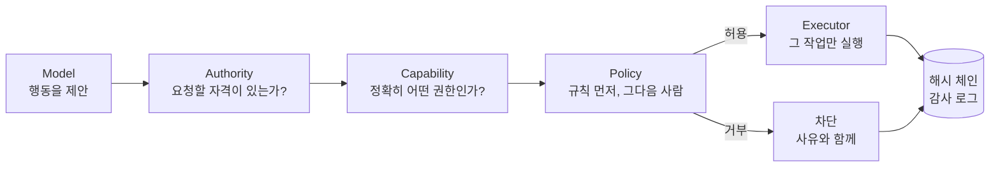

<p align="center">
  <picture>
    <source media="(prefers-color-scheme: dark)" srcset="docs/yana-banner-dark.svg">
    
  </picture>
</p>

<h3 align="center">모델은 제안하고, Yana는 결정하고, 사람이 통제합니다.</h3>

<p align="center">
  모든 AI 모델과 내 컴퓨터의 실제 권한 사이에 놓이는 로컬 컨트롤 플레인.
</p>

<p align="center">
  <a href="https://github.com/yanacuti1121/Yana-AI/actions/workflows/ci.yml"></a>
  <a href="https://crates.io/crates/yana-rt"></a>
  <a href="https://pypi.org/project/yana-ai/"></a>
  <a href="https://github.com/yanacuti1121/Yana-AI/releases/latest"></a>
  <a href="LICENSE"></a>
</p>

<p align="center">
  <a href="README.md">English</a> ·
  <a href="README.vi.md">Tiếng Việt</a> ·
  <a href="README.ko.md"><strong>한국어</strong></a> ·
  <a href="README.zh.md">中文</a>
</p>

<p align="center">
  <a href="#빠른-시작">빠른 시작</a> ·
  <a href="#동작-방식">동작 방식</a> ·
  <a href="#yana-studio">Yana Studio</a> ·
  <a href="#성능">성능</a> ·
  <a href="#보호-장치와-한계">한계</a> ·
  <a href="https://yana.vutam.link">웹사이트</a>
</p>

---

## 한눈에 보기

<table>
  <tr>
    <td align="center" width="25%"><h3>19</h3><sub>모델 provider<br>클라우드 13, 로컬 6</sub></td>
    <td align="center" width="25%"><h3>40</h3><sub>런타임 하위 명령<br>Rust 바이너리 하나</sub></td>
    <td align="center" width="25%"><h3>66</h3><sub>도구 호출 hook<br>Pre, Post, Stop</sub></td>
    <td align="center" width="25%"><h3>289</h3><sub>핵심 파일<br>SHA-256으로 고정</sub></td>
  </tr>
  <tr>
    <td align="center"><h3>4</h3><sub>에이전트 호스트<br>Claude Code, Codex, Cursor, Antigravity</sub></td>
    <td align="center"><h3>4.2 ms</h3><sub>런타임 시작 시간<br>릴리스 빌드, Apple M4</sub></td>
    <td align="center"><h3>100</h3><sub>전문 에이전트</sub></td>
    <td align="center"><h3>2,035</h3><sub>작업 지식 스킬,<br>권한은 부여하지 않음</sub></td>
  </tr>
</table>

개수는 CI가 실행하는 `core/scripts/check_counts.py`가 파일 시스템에서 직접 셉니다. 시간은
2026-10-20 로컬 측정값이며, 측정 방법은 [성능](#성능) 절에 있습니다.

## 빠른 시작

**데스크톱 앱.** Yana Studio는 [최신 릴리스](https://github.com/yanacuti1121/Yana-AI/releases/latest)
또는 [yana.vutam.link](https://yana.vutam.link)에서 받을 수 있습니다.

| 플랫폼 | 설치 파일 |
| --- | --- |
| macOS, Apple Silicon | `.dmg` 또는 `.zip` |
| Windows | `.exe`, x64 또는 ARM64 |
| Linux, x86_64 | `.deb` 또는 `.AppImage` |

**명령줄.** 이미 쓰고 있는 에이전트를 통제합니다:

```bash
pip install yana-ai    # Python CLI
yana-ai install        # 저장소에 Yana의 hook과 rule 추가
yana-ai doctor .       # 연결 상태 점검
cargo install yana-rt  # 네이티브 런타임, Python 불필요
```

Python 3.11+ (또는 Rust), Git, 지원되는 호스트 하나가 필요합니다. 전체 CLI 명령은
[COMMANDS.md](COMMANDS.md)에 있습니다. Yana는 npm에 배포되지 않습니다. [VERSIONING.md](VERSIONING.md)를 참고하세요.

> [!NOTE]
> macOS 빌드는 ad-hoc 서명이며 **공증(notarization)을 받지 않았습니다** (아직 Apple Developer
> 멤버십이 없음). 그래서 처음 실행할 때 Gatekeeper 경고가 뜹니다.
> [docs/MACOS_INSTALL.md](docs/MACOS_INSTALL.md)에 공식적인 두 가지 여는 방법이 있습니다.
> 릴리스마다 파일 목록이 다르니 내 플랫폼용 파일이 있는지 확인하고, `SHA256SUMS`가 있으면
> 대조하세요. Linux ARM 빌드는 없습니다.

## 동작 방식

모델은 무엇을 하고 싶은지 말할 수 있습니다. 그것이 허용되는지는 Yana가 결정하고, 사람은
언제든 멈출 수 있습니다. Claude, GPT, Gemini, DeepSeek, 내 컴퓨터에서 도는 모델 모두 같은
경로를 거칩니다.



스킬은 에이전트에게 일하는 방법을 가르칩니다. 행동할 권한을 주는 것은 capability뿐입니다.

### 시스템 구조

| 구성 요소 | 하는 일 | 상태 |
| --- | --- | --- |
| **[Yana Studio](tools/yana-studio)** | 실제 프로젝트를 위한 데스크톱 작업 공간: 파일, 편집기, 터미널, 채팅, 작업, 디자인 캔버스. |  |
| **[런타임 `yana-rt`](src)** | 모든 클라이언트와 모든 provider를 위한 하나의 턴 루프와 하나의 authority 계약을 가진 Rust 엔진. |  |
| **[Governance](core)** | Capability manifest, 사람의 승인, 해시 체인 감사 로그, core-lock 무결성. |  |
| **[Giám Thị](#giám-thị)** | AI 세션 밖에서 동작하는 감시자. 변조를 발견하면 이후 모든 도구 호출을 막습니다. |  |
| **[Harness adapters](adapters)** | Claude Code, Codex, Cursor, Antigravity. 집행 강도는 호스트마다 다릅니다. |  |
| **[지식 계층](core/skills)** | 에이전트에게 일하는 방법을 가르치는 에이전트, 스킬, 명령, 규칙. 권한은 부여하지 않습니다. |  |
| **[Yana OS](src/os)** | 로컬 관리 계층: 에이전트 신원, 자율 수준, 할당량, 상태, 격리. |  |
| **[Yana Desktop / Web](tools/yana-web)** | 이전 Electron 셸과 웹 UI. Studio는 별도로 다시 만든 것이지 껍데기만 바꾼 것이 아닙니다. |  |
| **[Yana Wheelbot](https://github.com/yanacuti1121/yana-wheelbot)** | ESP32-S3 기반 로봇 플랫폼, 별도 저장소. |  |

`사용 중`은 배포되어 실제로 쓰이고 있다는 뜻입니다. `개발 중`은 실제 코드는 있지만 기능이
완성되지 않았다는 뜻입니다. `실험적`은 선택적으로 켜야 하고 독립적으로 검증되지 않았다는 뜻입니다.

`yana-rt`의 하위 명령은 40개이며 Python 의존성이 없습니다. feature flag 뒤에 있는 명령까지
포함해, 모든 빌드 구성에 걸친 소스 기준 개수입니다.

```text
core/
├── hooks/    # 66개 PreToolUse / PostToolUse / Stop hook (셸 63, JavaScript 3)
├── rules/    # 71개 rule, 대부분 에이전트가 스스로 따르는 지침이고 일부만 hook이 집행
├── agents/   # 100개 전문 에이전트
├── skills/   # 2,035개 스킬
├── commands/ # 170개 Claude Code 슬래시 명령
└── config/
    └── core-lock.json    # SHA-256 manifest, 핵심 파일 288개 고정
```

## Yana Studio

<p align="center">
  
</p>

프로젝트에서 AI와 함께 일할 때 오가야 하는 것들을 한 창에 모았습니다. Studio는 `yana-rt`를
통해서만 모델과 통신하며, UI 계층은 provider를 직접 호출하지 않습니다.

| 영역 | 기능 |
| --- | --- |
| **파일과 편집기** | 실제 폴더를 열고, 파일 이름으로 검색하고, CodeMirror로 편집합니다. 8 MiB까지 편집할 수 있고, 더 큰 파일은 256 KiB 읽기 전용 창으로 열립니다. 저장할 때 외부 변경을 먼저 감지합니다. |
| **터미널** | 탭으로 여는 실제 PTY 세션, 또는 최대 12개 격자. |
| **Git** | 상태, worktree, diff를 읽기 전용으로. stage와 commit은 일부러 AI 도구에서 뺐습니다. |
| **채팅** | `yana-rt`로 스트리밍, 여러 대화 저장, 중지 버튼, 승인 요청, 토큰 사용량. |
| **모델** | 19개 provider 전부와 사용자 지정 OpenAI 호환 엔드포인트. 로컬 관리자가 9Router, Ollama, LM Studio, llama.cpp, TurboFieldfare, AirLLM을 감지합니다. API 키는 stdin으로 Rust에 전달되어 OS 키 저장소에 암호화되어 저장되며, 작업 공간 파일에는 남지 않습니다. |
| **작업** | 실제 `yana-rt task` 저장소 사용. 완료 표시에는 증거가 필요하고, `blocked`는 런타임이 계산합니다. |
| **디자인 캔버스** | 22개 컴포넌트, 휴대폰과 데스크톱 화면, 레이어, 실행 취소/다시 실행, 통제된 AI 제안을 갖춘 네이티브 캔버스. |
| **거버넌스 텔레메트리** | 무엇이 허용되고 무엇이 차단되었는지, 그리고 그 이유. |

아직 없는 것: 기기 목록, 에이전트 세션 화면, 모바일 페어링, SSH/Docker 실행, 기한부 권한
UI, 서명된 자동 업데이트. 화면별 상태는
[`tools/yana-studio/SCREEN-STATUS.md`](tools/yana-studio/SCREEN-STATUS.md)에 있습니다.

<details>
<summary><b>소스에서 Studio 빌드하기</b></summary>

Node 24+와 `node-pty`용 C++ 툴체인이 필요합니다.

```bash
cd tools/yana-studio
npm ci && npm run rebuild
npm run stage:runtime -- /yana-rt/의/절대/경로
npm start
```

</details>

## 런타임: `yana-rt`

하나의 Rust 바이너리가 모든 클라이언트의 턴 루프와 authority 검사를 맡기 때문에 Studio, CLI,
MCP가 각자 권한 로직을 다시 구현할 필요가 없습니다.

- **Provider:** anthropic, openai, gemini, groq, deepseek, openrouter, xai, novita, nvidia, minimax, glm, huggingface, 9router, kimi (클라우드), 그리고 ollama, lmstudio, llamacpp, turbofieldfare, airllm (로컬). 기준 목록은 [`src/model/catalog.rs`](src/model/catalog.rs)이며, 계약 테스트가 Studio와의 일치를 지킵니다.
- **장애 조치:** 타입이 있는 provider 오류, 대체 provider, credential pool 순환.
- **상태:** 전문 검색이 되는 SQLite 세션 저장소, 프로필별 상태, 충돌 복구, 롤백 가능한 shadow-git 체크포인트.
- **Capability 도구:** 파일 읽기/패치, 검증을 거친 명령 실행, stdio 기반 MCP 클라이언트, 검사된 HTTPS 계층을 거치는 `web.search`, 읽기 전용 LSP 클라이언트.
- **선택 기능:** `mcp`, `lsp`, `pty-bridge`, Discord 원격 어댑터. 기본 빌드에서는 꺼져 있습니다.

남은 런타임 작업은 [CURRENT-MILESTONE.md](CURRENT-MILESTONE.md)에 있습니다: 모든 클라이언트를
하나의 capability executor로 통합하는 것, 그리고 mock 대신 실제 로컬 모델로 도구 호출을
시험하는 것입니다.

## 성능

2026-10-20, Apple M4 MacBook Air (RAM 16 GB, macOS 27.2)에서 커밋 `986093f5`의 `yana-rt` 1.5.1
릴리스 빌드로 이 저장소를 대상으로 측정했습니다. 각 값은 3회 평균입니다 (시작 시간은 100회,
hook은 50회). Python 열은 각 Rust 명령이 대체하는 스크립트입니다. 마지막 열은 2026-08-26
측정값이며, 전체 이력과 방법은 [BENCHMARK.md](BENCHMARK.md)에 있습니다.

| 경로 | `yana-rt` | Python | 결과 | 출력 일치? | 2026-08-26 |
| --- | ---: | ---: | --- | --- | --- |
| 프로세스 시작 | **4.16 ms** | | | | 4.21 ms |
| `doctor` | **143 ms** | 415 ms | Rust 2.9배 빠름 | 예, 양쪽 16개 항목 (ok 11, 경고 1, info 4) | 255 ms, Rust 10개 항목 대 16개 |
| `ci check` | **5.8 ms** | 33 ms | Rust 5.7배 빠름 | 예, 양쪽 경고 5개 | 414 ms, Rust 0개 대 3개 |
| `scan core/skills` | **0.55 s** | 8.47 s | Rust 15.5배 빠름 | 같은 파일 (1,791 대 1,795), 같은 최상위 발견; 점수는 다름 (40 대 0) | 4.45 s |
| HALT 검사 hook | **5.4 ms** | | | | 3.80 ms |
| 파괴적 명령 guard | **4.9 ms** | | | | 측정 안 함 |

| 메모리와 크기 | `yana-rt` | Python |
| --- | ---: | ---: |
| 최대 RSS, `scan core/skills` | **17.7 MiB** | 26.5 MiB |
| 최대 RSS, 기본 전체 저장소 스캔 | **22.4 MiB** | 29.4 MiB |
| 릴리스 바이너리 | 18.2 MiB | |

8월 이후 `doctor`와 `ci check`는 Python과 출력이 일치하게 되었고 둘 다 빨라졌습니다. 릴리스
바이너리는 약 14 MiB에서 커졌습니다.

> [!WARNING]
> 기본 전체 저장소 `scan`은 아직 같은 조건의 비교가 아닙니다. Rust는 620개 파일을 0.36초에
> 훑고 발견 사항이 없었고, Python은 1,643개 파일을 6.14초에 훑고 critical `SE002` 9건을
> 보고했습니다. 이것은 맞춰야 할 차이이지 17배 빠르다는 뜻이 아닙니다.
> token-budget guard는 다시 측정하지 않았습니다. 새 worktree에서는 잠금 상태가 초기화되지
> 않아 일찍 종료하므로, 그때 잰 시간은 오류 경로만 측정합니다.

한 대의 기기에서 측정한 값입니다. Linux와 Windows는 측정하지 않았습니다.

## Giám Thị

AI 세션 밖에서, 운영체제 자체의 스케줄러(macOS의 launchd, Linux의 systemd timer, Windows의
작업 스케줄러)로 6시간마다 실행되는 독립 감시자입니다.

1. 집행을 제어하는 파일을 사람이 승인한 기준 커밋과 비교합니다: Claude Code, Codex, Cursor의 hook 설정, CI 워크플로, `core/rules`, `core/gates`, `core/hooks`, `core/scripts`, `src/guard`.
2. 차이를 발견하면 `GIAMTHI_HALT.lock`을 씁니다. 모든 도구 호출에서 가장 먼저 실행되는 hook이 잠금 파일이 있는 동안 모든 호출을 거부합니다.
3. 잠금은 사람이 파일을 지워야만 풀립니다. hook, 감시자, 환경 변수 어느 것도 풀 수 없습니다.

`yana-ai giamthi install | status | repair | uninstall`로 관리합니다. 선택 사항이며, 일정에 따라
돌기 때문에 변경과 잠금 사이에 최대 6시간의 간격이 있습니다. Codex는 셸 명령에만 `PreToolUse`를
호출하므로, Codex에서는 `SessionStart`와 `UserPromptSubmit`에서도 잠금을 확인합니다.

## Harness adapters

| 호스트 | 거버넌스 적용 방식 | 집행 수준 |
| --- | --- | --- |
| **Claude Code** | `.claude/`의 네이티브 hook과 rule | 모든 도구 호출을 런타임에서 차단, 해시 체인 감사 |
| **Codex** | `AGENTS.md`, `.codex/` hook, 동기화된 스킬과 에이전트 (`yana-ai install --engine codex`) | 프로젝트 범위 hook |
| **Cursor** | `.cursorrules`, `.cursor/rules`, `beforeShellExecution` hook | 셸 명령 검사; MCP 도구 호출은 미포함 |
| **Antigravity** | `.agents/rules/yana-ai.md`와 `.agents/hooks.json`의 `PreToolUse` hook (`yana-ai install --engine antigravity`) | 셸 명령을 `guard-destructive.sh`가 검사; Giám Thị HALT 잠금은 모든 도구 호출을 차단; `agy --dangerously-skip-permissions`에서는 건너뜀 |

자세한 내용과 전환 명령: [adapters/README.md](adapters/README.md). Claude Code 슬래시 명령 170개
(`/plan`, `/verify`, `/code-review` 등)는 `core/commands/`에 있으며 세션 안에서 실행됩니다.

## 보호 장치와 한계

| 보호 장치 | 하는 일 | 한계 |
| --- | --- | --- |
| **감사 로그** | 해시 체인이라 한 줄을 고치거나 지우면 드러납니다 (`core/scripts/verify-audit-chain.sh`). | 변조 탐지는 되지만 변조 방지는 아닙니다. |
| **Core-lock** | SHA-256 manifest가 `core/`의 변경, 삭제, 주입된 파일을 찾아냅니다. | 트리가 lock과 일치함을 증명할 뿐, 사람이 검토했음을 증명하지 않습니다: `core/`를 고칠 수 있으면 lock도 다시 만들 수 있습니다. 독립 검사는 Giám Thị가 맡습니다. |
| **사람 승인 관문** | force-push, publish, deploy, 삭제는 현재 세션에서 확인이 필요합니다. | 이전 승인은 이어지지 않습니다. |
| **Giám Thị** | 문제를 찾으면 사람이 잠금을 풀 때까지 이후 모든 도구 호출을 막습니다. | 선택 사항이고 주기적이며 즉시는 아닙니다. |
| **Rule과 hook** | hook은 런타임에서 차단합니다. | `core/rules`의 파일 대부분은 에이전트가 스스로 따르는 행동을 적은 것이고, hook에 연결된 부분만 집행됩니다. 코드 서명 파이프라인은 없습니다. |
| **파괴적 명령 guard** | `guard-destructive.sh`가 `rm -rf`, force-push, `DROP TABLE` 등을 막습니다. | 셸 문법 전체가 아니라 명령 문자열을 대조하므로, 의도적으로 만든 명령은 빠져나갈 수 있습니다. |

Antigravity는 셸 명령만 검사하고 `agy --dangerously-skip-permissions`에서는 우회되며, Cursor는 MCP 호출을 검사하지 않으며, Rust 런타임 없이 브라우저에서만
도는 웹 배포는 완전히 통제되지 않습니다. 자세한 내용: [알려진 한계](docs/reference/known-limitations.md).

## 버전

세 개의 축이 각자 번호와 레지스트리를 가집니다: 제품(배포되지 않음), crates.io의 `yana-rt`,
PyPI의 Python 패키지 `yana-ai`. `tools/` 아래의 앱은 각자의 태그로 GitHub Releases를 통해
배포됩니다 (Studio는 `studio-v*`). 현재 버전 번호는 금방 낡기 때문에 이 페이지에 일부러 적지
않으며, 위의 배지가 실시간으로 보여 줍니다. [VERSIONING.md](VERSIONING.md)를 참고하세요.

## 더 보기

[ARCHITECTURE.md](ARCHITECTURE.md) · [PHILOSOPHY.md](PHILOSOPHY.md) · [ROADMAP.md](ROADMAP.md) · [CURRENT-MILESTONE.md](CURRENT-MILESTONE.md) · [CHANGELOG.md](CHANGELOG.md) · [BENCHMARK.md](BENCHMARK.md) · [CONTRIBUTING.md](CONTRIBUTING.md) · [SECURITY.md](SECURITY.md) · [감사의 말](ACKNOWLEDGEMENTS.md) · [계보](docs/history/LINEAGE.md)

---

<p align="center">
  팀도 투자도 없이 한 사람이 만들었습니다: <b>Vũ Văn Tâm</b>, 베트남<br>
  <a href="https://yana.vutam.link/">yana.vutam.link</a> · phamlongh230@gmail.com · <a href="LICENSE">Apache 2.0</a>
</p>
