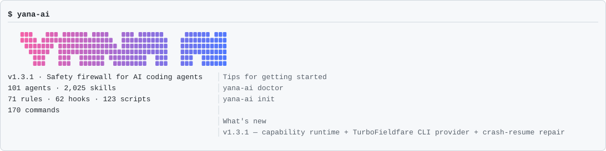

<p align="center">
  <picture>
    <source media="(prefers-color-scheme: dark)" srcset="docs/yana-banner-dark.svg">
    
  </picture>
</p>

<p align="center">
  <a href="README.md"><strong>English</strong></a> ·
  <a href="README.vi.md">Tiếng Việt</a> ·
  <a href="README.ko.md">한국어</a> ·
  <a href="README.zh.md">中文</a>
</p>

<h1 align="center">Yana AI 🐰</h1>

<p align="center">
  <a href="https://github.com/yanacuti1121/Yana-AI/actions/workflows/ci.yml"></a>
  <a href="https://crates.io/crates/yana-rt"></a>
  <a href="https://pypi.org/project/yana-ai/"></a>
  <a href="LICENSE"></a>
  <a href="CONTRIBUTING.md"></a>
</p>

<p align="center"><em>Created by Vũ Văn Tâm · Vietnam</em></p>

---

## Models propose. Yana decides. Humans stay in charge.

Yana is the control plane between an AI and real power. A model can say what it
wants to do. Yana decides whether that is allowed, and a person can always stop it.

```text
Model        proposes an action
   |
Authority    is this agent allowed to ask?
   |
Capability   what exact power is this?  (a small, fixed set)
   |
Policy       may it happen now?  rules first, then a human
   |
Executor     performs only the permitted operation
```

Any model goes through the same path: Claude, GPT, Gemini, DeepSeek, or one
running on your own machine. Skills teach an agent how to work; only a
capability can grant permission to act.

## System structure

| Component | What it does | Where | Status |
| --- | --- | --- | --- |
| **Yana Studio** | Desktop workspace (files, editor, terminals, chat, tasks) for working with AI on a real project. | [`tools/yana-studio`](tools/yana-studio) | Live, partial parity |
| **Runtime (`yana-rt`)** | Rust engine: one turn loop and one authority contract for local and cloud models, 19 providers. | [`src/`](src) | Live |
| **Governance** | Capability manifests, human approval, hash-chained audit log, core-lock integrity. | [`core/`](core) | Live |
| **Giám Thị** | Independent watcher outside any AI session. Halts every later tool call when it finds a problem. | [`core/scripts`](core/scripts) | Live, opt-in |
| **Harness adapters** | Claude Code, Codex, Cursor and Antigravity. Enforcement strength differs per host (see below). | [`adapters/`](adapters) | Live, varies by host |
| **Knowledge layer** | Agents, skills, commands and rules that teach agents how to work. They grant no permissions. | [`core/agents`](core/agents), [`core/skills`](core/skills) | Live |
| **Yana OS** | Local management plane: agent identity, autonomy levels, quotas, health, quarantine. | [`src/os`](src/os) | In development |
| **Yana Desktop / Yana Web** | Earlier Electron shell and web UI. Studio is a separate rebuild, not a reskin of these. | [`tools/yana-desktop`](tools/yana-desktop), [`tools/yana-web`](tools/yana-web) | Maintained separately |
| **Yana Wheelbot** | Robotics platform on ESP32-S3, in its own repository. | [`yana-wheelbot`](https://github.com/yanacuti1121/yana-wheelbot) | Experimental |

`Live` means shipped and in use. `In development` means real code exists but is
not feature-complete. `Experimental` means opt-in and not independently verified.

`yana-rt` has 40 subcommands. Zero Python dependency. This is the source-defined count across feature builds, including feature-gated ones.

```text
core/
├── hooks/    # 66 PreToolUse / PostToolUse / Stop hooks (63 shell, 3 JavaScript)
├── rules/    # 71 rules, most are guidance the agent applies; hooks enforce a subset
├── agents/   # 100 specialist agents
├── skills/   # 2,026 skills
├── commands/ # 170 Claude Code slash commands
└── config/
    └── core-lock.json    # SHA-256 manifest — 287 core files pinned
```

These counts are derived from the filesystem by `core/scripts/check_counts.py`, which
CI runs, so they should not drift from the tree.

## Yana Studio

One window for the things you switch between when working with AI on a project.
Studio talks to the model only through `yana-rt`; it never calls a provider from
the UI layer.

- **Files and editor:** open a real folder, search filenames across it, edit with CodeMirror. Files up to 8 MiB are editable; larger ones open as read-only 256 KiB windows. Saves detect outside changes before overwriting.
- **Terminals:** real PTY sessions in tabs, or a grid of up to 12.
- **Git:** read-only status, worktrees and diffs. Stage and commit are deliberately not AI tools.
- **Chat:** streamed through `yana-rt`, multiple saved conversations, stop button, approval prompts, token usage.
- **Models:** all 19 providers (13 cloud, 6 local) plus a custom OpenAI-compatible endpoint. A local manager detects 9Router, Ollama, LM Studio, llama.cpp, TurboFieldfare and AirLLM. API keys go to Rust over stdin and are stored encrypted with the OS keystore, never in workspace files.
- **Tasks:** create, list, depend and drop tasks against the real `yana-rt task` store. Marking done requires evidence, and `blocked` is always computed by the runtime.
- **Design canvas:** native canvas with 22 components, phone and desktop screens, layers, undo/redo, and guarded AI proposals.
- **Governance telemetry:** what was allowed, what was blocked, and why.

Not built yet: device registry, agent sessions screen, mobile pairing, SSH/Docker
execution, permission-lease UI, signed auto-update. The per-screen status is in
[`tools/yana-studio/SCREEN-STATUS.md`](tools/yana-studio/SCREEN-STATUS.md).

Download from the [latest release](https://github.com/yanacuti1121/Yana-AI/releases/latest)
or [yana.vutam.link](https://yana.vutam.link).

| Platform | Installer |
| --- | --- |
| macOS, Apple Silicon | `.dmg` or `.zip` |
| Windows | `.exe`, x64 or ARM64 |
| Linux, x86_64 | `.deb` or `.AppImage` |

Each release lists its own assets, so check that your platform is there, and verify
against `SHA256SUMS` when provided. There is no Linux ARM build. The macOS build is
ad-hoc signed and **not notarized** (no Apple Developer membership yet), so Gatekeeper
warns on first launch; [docs/MACOS_INSTALL.md](docs/MACOS_INSTALL.md) shows the two
official ways to open it.

Build from source (Node 24+ and a C++ toolchain for `node-pty`):

```bash
cd tools/yana-studio
npm ci && npm run rebuild
npm run stage:runtime -- /absolute/path/to/yana-rt
npm start
```

## Runtime: `yana-rt`

A single Rust binary that owns the turn loop and the authority check for every client,
so Studio, the CLI and MCP do not each reimplement permission logic.

- **19 providers:** anthropic, openai, gemini, groq, deepseek, openrouter, xai, novita, nvidia, minimax, glm, huggingface, 9router, kimi (cloud), and ollama, lmstudio, llamacpp, turbofieldfare, airllm (local). The canonical list is [`src/model/catalog.rs`](src/model/catalog.rs); a contract test keeps Studio in sync with it.
- **Failover:** typed provider errors, fallback providers and credential-pool rotation.
- **State:** SQLite session store with full-text search, per-profile state, crash recovery, and shadow-git checkpoints with rollback.
- **Capability tools:** file read/patch, command execution under validation, MCP client over stdio, `web.search` through a checked HTTPS layer, and a read-only LSP client.
- **Optional features:** `mcp`, `lsp`, `pty-bridge`, Discord remote adapter. They are off in the default build.

Remaining work on the runtime is tracked in [CURRENT-MILESTONE.md](CURRENT-MILESTONE.md).
At the time of writing: unifying every client on one capability executor, and running
local-model tool calling against a real local model rather than a mock.

## Giám Thị

An independent watcher that runs outside any AI session, from the operating system's
own scheduler: launchd on macOS, a systemd timer on Linux, Task Scheduler on Windows,
every 6 hours.

- It compares the repo against a baseline commit a human approved, over the files that control enforcement: hook settings for Claude Code, Codex and Cursor, CI workflows, `core/rules`, `core/gates`, `core/hooks`, `core/scripts` and `src/guard`.
- On drift it writes `GIAMTHI_HALT.lock`. A hook that runs first on every tool call then denies everything while the lock exists.
- Only a person deleting the lock clears it. Neither the hook, the watcher nor any environment variable can.
- Manage it with `yana-ai giamthi install | status | repair | uninstall`.

It is opt-in. Because it runs on a schedule, there is a window of up to 6 hours between a
change and the halt. Codex fires `PreToolUse` only for shell commands, so Yana also
checks the lock on `SessionStart` and `UserPromptSubmit` for Codex.

## Harness adapters

| Host | How governance is applied | Enforcement |
| --- | --- | --- |
| **Claude Code** | Native hooks and rules in `.claude/` | Runtime blocking on every tool call, hash-chained audit |
| **Codex** | `AGENTS.md`, `.codex/` hooks, synced skills and agents (`yana-ai install --engine codex`) | Project-scoped hooks |
| **Cursor** | `.cursorrules`, `.cursor/rules`, a `beforeShellExecution` hook | Shell commands screened; MCP tool calls are not covered |
| **Antigravity** | `.agent/rules/yana-ai.md` | Advisory only, not enforced at the shell |

Details and switching commands: [adapters/README.md](adapters/README.md).

## Command line

```bash
pip install yana-ai    # Python CLI
yana-ai install        # add Yana's hooks and rules to your repo
yana-ai doctor .       # check that everything is wired
cargo install yana-rt  # native runtime, no Python needed
```

Needs Python 3.11+ (or Rust), Git, and one supported harness. All CLI commands are in
[COMMANDS.md](COMMANDS.md). The 170 Claude Code slash commands (`/plan`, `/verify`,
`/code-review` and others) live in `core/commands/` and run inside a session.
Yana is not published to npm, see [VERSIONING.md](VERSIONING.md).

## What protects you, and where it stops

- **Audit log:** hash-chained, so editing or deleting a line is detectable (`core/scripts/verify-audit-chain.sh`). It is tamper-detectable, not tamper-proof.
- **Core-lock:** a SHA-256 manifest detects changed, deleted or injected files in `core/`. It proves the tree matches the lock file, not that a human reviewed the change: whoever can edit `core/` can also regenerate the lock. Giám Thị is the independent check for that.
- **Human gate:** force-push, publish, deploy and delete need confirmation in the current session; earlier approval does not carry over.
- **Giám Thị:** opt-in, runs outside any AI session, and on a finding locks every later tool call until a person removes the lock. It is periodic, not instant.
- **Rules versus hooks:** most files in `core/rules` describe behaviour the agent applies to itself. Only what is wired into a hook is enforced. There is no code-signing pipeline.
- **Limits:** `guard-destructive.sh` matches command strings, not a full shell parse, so a deliberately crafted command can slip past it. Antigravity is advisory, and Cursor does not screen MCP calls. Browser-only web deployments without the Rust runtime are not fully governed. Details: [known limitations](docs/reference/known-limitations.md).

## Versioning

Three axes, each with its own number and registry: the product (not distributed),
`yana-rt` on crates.io, and the `yana-ai` Python package on PyPI. Apps under `tools/`
ship through GitHub Releases with their own tags (`studio-v*` for Studio). The numbers are
deliberately not repeated here, since they go stale. See [VERSIONING.md](VERSIONING.md).

## More

[ARCHITECTURE.md](ARCHITECTURE.md) · [PHILOSOPHY.md](PHILOSOPHY.md) · [ROADMAP.md](ROADMAP.md) · [CURRENT-MILESTONE.md](CURRENT-MILESTONE.md) · [CHANGELOG.md](CHANGELOG.md) · [CONTRIBUTING.md](CONTRIBUTING.md) · [SECURITY.md](SECURITY.md) · [Acknowledgements](ACKNOWLEDGEMENTS.md) · [Lineage](docs/history/LINEAGE.md)

Built by one person, no team, no funding: **Vũ Văn Tâm**, Vietnam ·
[yana.vutam.link](https://yana.vutam.link/) · phamlongh230@gmail.com · [Apache 2.0](LICENSE)
