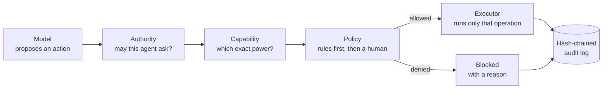

<p align="center">
  <picture>
    <source media="(prefers-color-scheme: dark)" srcset="docs/yana-banner-dark.svg">
    
  </picture>
</p>

<h3 align="center">Models propose. Yana decides. Humans stay in charge.</h3>

<p align="center">
  A local control plane that sits between any AI model and real power over your machine.
</p>

<p align="center">
  <a href="https://merx.help/shield"></a>
  <a href="https://github.com/yanacuti1121/Yana-AI/actions/workflows/ci.yml"></a>
  <a href="https://crates.io/crates/yana-rt"></a>
  <a href="https://pypi.org/project/yana-ai/"></a>
  <a href="https://github.com/yanacuti1121/Yana-AI/releases/latest"></a>
  <a href="LICENSE"></a>
</p>

<p align="center">
  <a href="README.md"><strong>English</strong></a> ·
  <a href="README.vi.md">Tiếng Việt</a> ·
  <a href="README.ko.md">한국어</a> ·
  <a href="README.zh.md">中文</a>
</p>

<p align="center">
  <a href="#quick-start">Quick start</a> ·
  <a href="#how-it-works">How it works</a> ·
  <a href="#yana-studio">Yana Studio</a> ·
  <a href="#performance">Performance</a> ·
  <a href="#what-protects-you-and-where-it-stops">Limits</a> ·
  <a href="https://yana.vutam.link">Website</a>
</p>

---

## At a glance

<table>
  <tr>
    <td align="center" width="25%"><h3>19</h3><sub>model providers<br>13 cloud, 6 local</sub></td>
    <td align="center" width="25%"><h3>41</h3><sub>runtime subcommands<br>in one Rust binary</sub></td>
    <td align="center" width="25%"><h3>66</h3><sub>tool-call hooks<br>Pre, Post and Stop</sub></td>
    <td align="center" width="25%"><h3>289</h3><sub>core files<br>pinned by SHA-256</sub></td>
  </tr>
  <tr>
    <td align="center"><h3>4</h3><sub>agent hosts<br>Claude Code, Codex, Cursor, Antigravity</sub></td>
    <td align="center"><h3>4.2 ms</h3><sub>runtime startup<br>release build, Apple M4</sub></td>
    <td align="center"><h3>100 agents</h3><sub>specialist personas</sub></td>
    <td align="center"><h3>2,035 skills</h3><sub>working knowledge,<br>no permissions</sub></td>
  </tr>
</table>

Counts are derived from the filesystem by `core/scripts/check_counts.py`, which CI runs.
Timings are local measurements from 2026-10-20; the method is under [Performance](#performance).

## Quick start

**Desktop app.** Download Yana Studio (v1.7.0) from the
[latest release](https://github.com/yanacuti1121/Yana-AI/releases/latest) or
[yana.vutam.link](https://yana.vutam.link).

| Platform | Installer |
| --- | --- |
| macOS, Apple Silicon | `.dmg` or `.zip` |

**Command line.** Govern the agent you already use:

```bash
pip install yana-ai    # Python CLI
yana-ai install        # add Yana's hooks and rules to your repo
yana-ai doctor .       # check that everything is wired
cargo install yana-rt  # native runtime, no Python needed
```

Needs Python 3.11+ (or Rust), Git, and one supported host. All CLI commands are in
[COMMANDS.md](COMMANDS.md). Yana is not published to npm, see [VERSIONING.md](VERSIONING.md).

> [!NOTE]
> The macOS build is ad-hoc signed and **not notarized** (no Apple Developer
> membership yet), so Gatekeeper warns on first launch.
> [docs/MACOS_INSTALL.md](docs/MACOS_INSTALL.md) shows the two official ways to open it.
> Each release lists its own assets: check that your platform is there and verify
> against `SHA256SUMS` when provided. There is no Linux ARM build.

## How it works

A model can say what it wants to do. Yana decides whether that is allowed, and a
person can always stop it. Every model takes the same path: Claude, GPT, Gemini,
DeepSeek, or one running on your own machine.



Skills teach an agent how to work. Only a capability can grant permission to act.

### System structure

| Component | What it does | Status |
| --- | --- | --- |
| **[Yana Studio](tools/yana-studio)** | Desktop workspace: files, editor, terminals, chat, tasks and a design canvas for a real project (v1.7.0). |  |
| **[Yana IDE](tools/yana-ide)** | Deeply customized VS Code agent workspace with Yana agent cockpit and office tools. |  |
| **[Runtime `yana-rt`](src)** | Rust engine with one turn loop and one authority contract for every client and every provider. |  |
| **[Governance](core)** | Capability manifests, human approval, hash-chained audit log, core-lock integrity. |  |
| **[Giám Thị](#giám-thị)** | Watcher outside any AI session that halts every later tool call when it finds drift. |  |
| **[Harness adapters](adapters)** | Claude Code, Codex, Cursor and Antigravity. Enforcement strength differs per host. |  |
| **[Knowledge layer](core/skills)** | 100 agents, 2,035 skills, commands and rules that teach agents how to work. They grant no permissions. |  |
| **[Yana OS](src/os)** | Local management plane: agent identity, autonomy levels, quotas, health, quarantine. |  |
| **[Yana Desktop / Web](tools/yana-web)** | Earlier Electron shell and web UI. Studio is a separate rebuild, not a reskin. |  |
| **[Yana Wheelbot](https://github.com/yanacuti1121/yana-wheelbot)** | Robotics platform on ESP32-S3, in its own repository. |  |

`Live` means shipped and in use. `In development` means real code exists but is not
feature-complete. `Experimental` means opt-in and not independently verified.

`yana-rt` has 41 subcommands. Zero Python dependency. This is the source-defined count across feature builds, including feature-gated ones.

```text
core/
├── hooks/    # 66 PreToolUse / PostToolUse / Stop hooks (63 shell, 3 JavaScript)
├── rules/    # 71 rules, most are guidance the agent applies; hooks enforce a subset
├── agents/   # 100 specialist agents
├── skills/   # 2,035 skills
├── commands/ # 170 Claude Code slash commands
└── config/
    └── core-lock.json    # SHA-256 manifest — 289 core files pinned
```

## Yana Studio (v1.7.0)

<p align="center">
  
</p>

One window for the things you switch between when working with AI on a project.
Studio talks to models only through `yana-rt`; the UI layer never calls a provider.

| Area | What you get |
| --- | --- |
| **Files and editor** | Open a real folder, search filenames, edit with CodeMirror. Files up to 8 MiB are editable; larger ones open as read-only 256 KiB windows. Saves detect outside changes before overwriting. |
| **Terminals** | Real PTY sessions in tabs, or a grid of up to 12. |
| **Git** | Read-only status, worktrees and diffs. Stage and commit are deliberately not AI tools. |
| **Chat** | Streamed through `yana-rt`, saved conversations, stop button, approval prompts, token usage. |
| **Models** | All 19 providers plus a custom OpenAI-compatible endpoint. A local manager detects 9Router, Ollama, LM Studio, llama.cpp, TurboFieldfare and AirLLM. API keys reach Rust over stdin and are stored encrypted in the OS keystore, never in workspace files. |
| **Tasks** | Backed by the real `yana-rt task` store. Marking done requires evidence, and `blocked` is computed by the runtime. |
| **Design canvas** | Native canvas with 22 components, phone and desktop screens, layers, undo/redo and guarded AI proposals. |
| **Governance telemetry** | What was allowed, what was blocked, and why. |

Not built yet: device registry, agent sessions screen, mobile pairing, SSH/Docker
execution, permission-lease UI, signed auto-update. Per-screen status lives in
[`tools/yana-studio/SCREEN-STATUS.md`](tools/yana-studio/SCREEN-STATUS.md).

<details>
<summary><b>Build Studio from source</b></summary>

Needs Node 24+ and a C++ toolchain for `node-pty`.

```bash
cd tools/yana-studio
npm ci && npm run rebuild
npm run stage:runtime -- /absolute/path/to/yana-rt
npm start
```

</details>

## Runtime: `yana-rt`

A single Rust binary owns the turn loop and the authority check for every client, so
Studio, the CLI and MCP do not each reimplement permission logic.

- **Providers:** anthropic, openai, gemini, groq, deepseek, openrouter, xai, novita, nvidia, minimax, glm, huggingface, 9router, kimi (cloud), and ollama, lmstudio, llamacpp, turbofieldfare, airllm (local). The canonical list is [`src/model/catalog.rs`](src/model/catalog.rs); a contract test keeps Studio in sync with it.
- **Failover:** typed provider errors, fallback providers and credential-pool rotation.
- **State:** SQLite session store with full-text search, per-profile state, crash recovery, and shadow-git checkpoints with rollback.
- **Capability tools:** file read/patch, command execution under validation, MCP client over stdio, `web.search` through a checked HTTPS layer, and a read-only LSP client.
- **Optional features:** `mcp`, `lsp`, `pty-bridge`, Discord remote adapter. They are off in the default build.

Remaining runtime work is tracked in [CURRENT-MILESTONE.md](CURRENT-MILESTONE.md): unifying
every client on one capability executor, and testing local-model tool calling against a
real local model rather than a mock.

## Performance

Measured 2026-10-20 on an Apple M4 MacBook Air (16 GB RAM, macOS 27.2), `yana-rt` 1.5.1
release build at commit `986093f5`, against this repository. Each figure is the mean of
3 runs (100 for startup, 50 for hooks). The Python column is the script that each Rust
command replaces. The last column is the 2026-08-26 snapshot; full history and method
are in [BENCHMARK.md](BENCHMARK.md).

| Path | `yana-rt` | Python | Result | Same output? | 2026-08-26 |
| --- | ---: | ---: | --- | --- | --- |
| Process startup | **4.16 ms** | | | | 4.21 ms |
| `doctor` | **143 ms** | 415 ms | Rust 2.9x faster | Yes, 16 checks each (11 ok, 1 warn, 4 info) | 255 ms, Rust ran 10 checks vs 16 |
| `ci check` | **5.8 ms** | 33 ms | Rust 5.7x faster | Yes, 5 warnings each | 414 ms, Rust found 0 vs 3 |
| `scan core/skills` | **0.55 s** | 8.47 s | Rust 15.5x faster | Same files (1,791 vs 1,795) and top finding; scores differ (40 vs 0) | 4.45 s |
| HALT check hook | **5.4 ms** | | | | 3.80 ms |
| Destructive-command guard | **4.9 ms** | | | | not measured |

| Memory and size | `yana-rt` | Python |
| --- | ---: | ---: |
| Peak RSS, `scan core/skills` | **17.7 MiB** | 26.5 MiB |
| Peak RSS, default full-repo scan | **22.4 MiB** | 29.4 MiB |
| Release binary | 18.2 MiB | |

Since August, `doctor` and `ci check` reached output parity with Python and both got
faster. The release binary grew from about 14 MiB.

> [!WARNING]
> The default full-repo `scan` is not a like-for-like comparison yet. Rust covers 620
> files and reported no findings in 0.36 s; Python covers 1,643 files and reported 9
> critical `SE002` findings in 6.14 s. That is a parity gap to close, not a 17x speedup.
> The token-budget guard was not re-measured: in a fresh worktree it exits early because
> its lock state is not initialised, so a timing would only measure the error path.

These are single-machine numbers. Linux and Windows are not measured.

## Giám Thị

An independent watcher that runs outside any AI session, from the operating system's
own scheduler (launchd on macOS, a systemd timer on Linux, Task Scheduler on Windows)
every 6 hours.

1. It compares the repo against a baseline commit a human approved, over the files that control enforcement: hook settings for Claude Code, Codex and Cursor, CI workflows, `core/rules`, `core/gates`, `core/hooks`, `core/scripts` and `src/guard`.
2. On drift it writes `GIAMTHI_HALT.lock`. A hook that runs first on every tool call then denies everything while the lock exists.
3. Only a person deleting the lock clears it. Neither the hook, the watcher nor any environment variable can.

Manage it with `yana-ai giamthi install | status | repair | uninstall`. It is opt-in, and
because it runs on a schedule there is a window of up to 6 hours between a change and
the halt. Codex fires `PreToolUse` only for shell commands, so Yana also checks the lock
on `SessionStart` and `UserPromptSubmit` for Codex.

## Harness adapters

| Host | How governance is applied | Enforcement |
| --- | --- | --- |
| **Claude Code** | Native hooks and rules in `.claude/` | Runtime blocking on every tool call, hash-chained audit |
| **Codex** | `AGENTS.md`, `.codex/` hooks, synced skills and agents (`yana-ai install --engine codex`) | Project-scoped hooks |
| **Cursor** | `.cursorrules`, `.cursor/rules`, a `beforeShellExecution` hook | Shell commands screened; MCP tool calls are not covered |
| **Antigravity** | `.agents/rules/yana-ai.md` and a `PreToolUse` hook in `.agents/hooks.json` (`yana-ai install --engine antigravity`) | Shell commands screened by `guard-destructive.sh`; a Giám Thị halt blocks every tool call; skipped by `agy --dangerously-skip-permissions` |

Details and switching commands: [adapters/README.md](adapters/README.md). The 170 Claude Code
slash commands (`/plan`, `/verify`, `/code-review` and others) live in `core/commands/`
and run inside a session.

## What protects you, and where it stops

| Protection | What it does | Where it stops |
| --- | --- | --- |
| **Audit log** | Hash-chained, so editing or deleting a line is detectable (`core/scripts/verify-audit-chain.sh`). | Tamper-detectable, not tamper-proof. |
| **Core-lock** | SHA-256 manifest detects changed, deleted or injected files in `core/`. | Proves the tree matches the lock, not that a human reviewed it: whoever can edit `core/` can regenerate the lock. Giám Thị is the independent check. |
| **Human gate** | Force-push, publish, deploy and delete need confirmation in the current session. | Earlier approval does not carry over. |
| **Giám Thị** | Locks every later tool call on a finding until a person removes the lock. | Opt-in and periodic, not instant. |
| **Rules and hooks** | Hooks block at runtime. | Most files in `core/rules` describe behaviour the agent applies to itself; only what a hook wires in is enforced. There is no code-signing pipeline. |
| **Destructive guard** | `guard-destructive.sh` blocks `rm -rf`, force-push, `DROP TABLE` and similar. | Matches command strings, not a full shell parse, so a crafted command can slip past. |

Antigravity screens shell commands only and is bypassed by `agy --dangerously-skip-permissions`, Cursor does not screen MCP calls, and browser-only web
deployments without the Rust runtime are not fully governed. Details:
[known limitations](docs/reference/known-limitations.md).

## Versioning

Three axes, each with its own number and registry: the product (not distributed),
`yana-rt` on crates.io, and the `yana-ai` Python package on PyPI. Apps under `tools/` ship
through GitHub Releases with their own tags (`studio-v*` for Studio). Current version
numbers are left out of this page on purpose, since they go stale; the badges above read
them live. See [VERSIONING.md](VERSIONING.md).

## More

[ARCHITECTURE.md](ARCHITECTURE.md) · [PHILOSOPHY.md](PHILOSOPHY.md) · [ROADMAP.md](ROADMAP.md) · [CURRENT-MILESTONE.md](CURRENT-MILESTONE.md) · [CHANGELOG.md](CHANGELOG.md) · [BENCHMARK.md](BENCHMARK.md) · [CONTRIBUTING.md](CONTRIBUTING.md) · [SECURITY.md](SECURITY.md) · [Acknowledgements](ACKNOWLEDGEMENTS.md) · [Lineage](docs/history/LINEAGE.md)

---

<p align="center">
  Built by one person, no team, no funding: <b>Vũ Văn Tâm</b>, Vietnam<br>
  <a href="https://yana.vutam.link/">yana.vutam.link</a> · phamlongh230@gmail.com · <a href="LICENSE">Apache 2.0</a>
</p>
