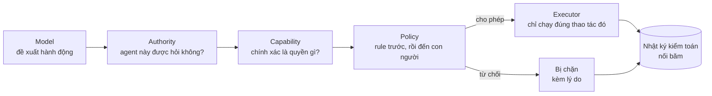
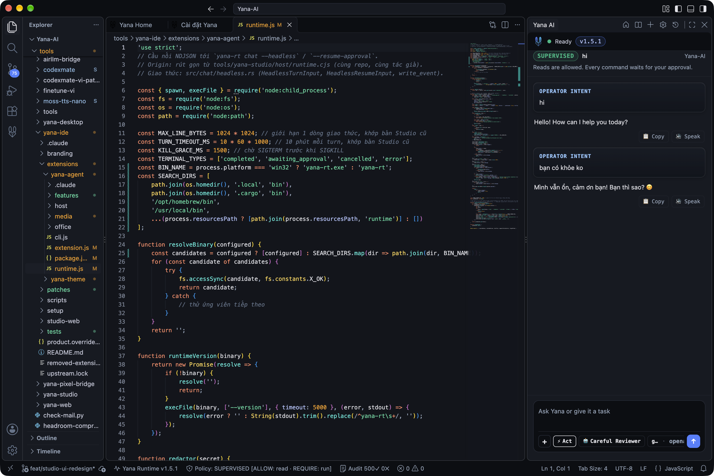

<p align="center">
  <picture>
    <source media="(prefers-color-scheme: dark)" srcset="docs/yana-banner-dark.svg">
    
  </picture>
</p>

<h3 align="center">Model đề xuất. Yana quyết định. Con người nắm quyền.</h3>

<p align="center">
  Lớp điều khiển chạy trên máy bạn, đứng giữa mọi model AI và quyền lực thật trên máy.
</p>

<p align="center">
  <a href="https://github.com/yanacuti1121/Yana-AI/actions/workflows/ci.yml"></a>
  <a href="https://crates.io/crates/yana-rt"></a>
  <a href="https://pypi.org/project/yana-ai/"></a>
  <a href="https://github.com/yanacuti1121/Yana-AI/releases/latest"></a>
  <a href="LICENSE"></a>
</p>

<p align="center">
  <a href="README.md">English</a> ·
  <a href="README.vi.md"><strong>Tiếng Việt</strong></a> ·
  <a href="README.ko.md">한국어</a> ·
  <a href="README.zh.md">中文</a>
</p>

<p align="center">
  <a href="#bắt-đầu-nhanh">Bắt đầu nhanh</a> ·
  <a href="#cách-hoạt-động">Cách hoạt động</a> ·
  <a href="#yana-studio">Yana Studio</a> ·
  <a href="#hiệu-năng">Hiệu năng</a> ·
  <a href="#điều-gì-bảo-vệ-bạn-và-nó-dừng-ở-đâu">Giới hạn</a> ·
  <a href="https://yana.vutam.link">Website</a>
</p>

---

## Tổng quan

<table>
  <tr>
    <td align="center" width="25%"><h3>19</h3><sub>provider model<br>13 cloud, 6 local</sub></td>
    <td align="center" width="25%"><h3>40</h3><sub>subcommand runtime<br>trong một binary Rust</sub></td>
    <td align="center" width="25%"><h3>66</h3><sub>hook cho tool call<br>Pre, Post và Stop</sub></td>
    <td align="center" width="25%"><h3>287</h3><sub>file lõi<br>được ghim bằng SHA-256</sub></td>
  </tr>
  <tr>
    <td align="center"><h3>4</h3><sub>host agent<br>Claude Code, Codex, Cursor, Antigravity</sub></td>
    <td align="center"><h3>4,2 ms</h3><sub>khởi động runtime<br>bản release, Apple M4</sub></td>
    <td align="center"><h3>100</h3><sub>agent chuyên biệt</sub></td>
    <td align="center"><h3>2.026</h3><sub>skill kiến thức làm việc,<br>không cấp quyền</sub></td>
  </tr>
</table>

Các con số được đếm từ hệ thống file bằng `core/scripts/check_counts.py`, CI chạy script
này. Thời gian đo trên máy cục bộ ngày 20/10/2026; cách đo nằm ở mục [Hiệu năng](#hiệu-năng).

## Bắt đầu nhanh

**Ứng dụng desktop.** Tải Yana Studio từ
[bản phát hành mới nhất](https://github.com/yanacuti1121/Yana-AI/releases/latest) hoặc
[yana.vutam.link](https://yana.vutam.link).

| Nền tảng | Bộ cài |
| --- | --- |
| macOS, Apple Silicon | `.dmg` hoặc `.zip` |
| Windows | `.exe`, x64 hoặc ARM64 |
| Linux, x86_64 | `.deb` hoặc `.AppImage` |

**Dòng lệnh.** Quản trị agent bạn đang dùng:

```bash
pip install yana-ai    # CLI Python
yana-ai install        # thêm hook và rule của Yana vào repo của bạn
yana-ai doctor .       # kiểm tra mọi thứ đã nối đúng chưa
cargo install yana-rt  # runtime native, không cần Python
```

Cần Python 3.11+ (hoặc Rust), Git và một host được hỗ trợ. Toàn bộ lệnh CLI nằm trong
[COMMANDS.md](COMMANDS.md). Yana không phát hành lên npm, xem [VERSIONING.md](VERSIONING.md).

> [!NOTE]
> Bản macOS được ký ad-hoc và **chưa được Apple notarize** (dự án chưa có tài khoản
> Apple Developer), nên Gatekeeper sẽ cảnh báo khi mở lần đầu.
> [docs/MACOS_INSTALL.md](docs/MACOS_INSTALL.md) hướng dẫn hai cách chính thức để mở.
> Mỗi bản phát hành có danh sách file riêng: hãy kiểm tra có bản cho nền tảng của bạn,
> và đối chiếu với `SHA256SUMS` khi có. Chưa có bản Linux ARM.

## Cách hoạt động

Model có thể nói nó muốn làm gì. Yana quyết định việc đó có được phép hay không, và con
người luôn có thể dừng nó lại. Mọi model đều đi cùng một đường: Claude, GPT, Gemini,
DeepSeek, hay model chạy ngay trên máy bạn.



Skill dạy agent cách làm việc. Chỉ capability mới cấp quyền hành động.

### Cấu trúc hệ thống

| Thành phần | Làm gì | Trạng thái |
| --- | --- | --- |
| **[Yana Studio](tools/yana-studio)** | Không gian làm việc desktop: file, editor, terminal, chat, task và canvas thiết kế cho một dự án thật (v1.7.0). |  |
| **[Yana IDE](tools/yana-ide)** | Không gian làm việc agent trên nền VS Code được tùy biến sâu với Yana agent cockpit và công cụ office. |  |
| **[Runtime `yana-rt`](src)** | Engine Rust với một vòng lặp turn và một hợp đồng authority cho mọi client, mọi provider. |  |
| **[Governance](core)** | Capability manifest, phê duyệt của con người, nhật ký kiểm toán nối băm, toàn vẹn core-lock. |  |
| **[Giám Thị](#giám-thị)** | Bộ giám sát chạy ngoài mọi phiên AI, khóa mọi tool call về sau khi phát hiện sai lệch. |  |
| **[Harness adapters](adapters)** | Claude Code, Codex, Cursor và Antigravity. Mức thực thi khác nhau tùy host. |  |
| **[Lớp tri thức](core/skills)** | 60 agent, 2.027 skill, command và rule dạy agent cách làm việc. Chúng không cấp quyền nào. |  |
| **[Yana OS](src/os)** | Lớp quản lý cục bộ: danh tính agent, mức tự chủ, quota, sức khỏe, cách ly. |  |
| **[Yana Desktop / Web](tools/yana-web)** | Vỏ Electron và giao diện web đời trước. Studio là bản dựng lại riêng, không phải đổi giao diện. |  |
| **[Yana Wheelbot](https://github.com/yanacuti1121/yana-wheelbot)** | Nền tảng robot trên ESP32-S3, nằm trong repository riêng. |  |

`Đang dùng` nghĩa là đã phát hành và được sử dụng. `Đang phát triển` nghĩa là đã có code
thật nhưng chưa đủ tính năng. `Thử nghiệm` nghĩa là tùy chọn bật và chưa được kiểm chứng
độc lập.

`yana-rt` có 40 subcommand, không phụ thuộc Python. Đây là số đếm theo mã nguồn trên mọi
cấu hình build, kể cả các lệnh nằm sau feature flag.

```text
core/
├── hooks/    # 66 hook PreToolUse / PostToolUse / Stop (63 shell, 3 JavaScript)
├── rules/    # 71 rule, phần lớn là hướng dẫn agent tự áp dụng; hook thực thi một phần
├── agents/   # 60 agent chuyên biệt
├── skills/   # 2.027 skill
├── commands/ # 170 slash command của Claude Code
└── config/
    └── core-lock.json    # manifest SHA-256, ghim 287 file lõi
```

## Yana Studio (v1.7.0)

<p align="center">
  
</p>

Một cửa sổ cho những thứ bạn hay phải chuyển qua lại khi làm việc với AI trên một dự án.
Studio chỉ nói chuyện với model qua `yana-rt`; lớp giao diện không bao giờ gọi provider.

| Khu vực | Có gì |
| --- | --- |
| **File và editor** | Mở thư mục thật, tìm theo tên file, sửa bằng CodeMirror. File đến 8 MiB sửa được; file lớn hơn mở dạng cửa sổ chỉ đọc 256 KiB. Khi lưu, Studio phát hiện thay đổi từ bên ngoài trước khi ghi đè. |
| **Terminal** | Phiên PTY thật theo tab, hoặc lưới tối đa 12 phiên. |
| **Git** | Trạng thái, worktree và diff, chỉ đọc. Stage và commit cố ý không phải là tool của AI. |
| **Chat** | Stream qua `yana-rt`, lưu nhiều cuộc trò chuyện, nút dừng, hỏi phê duyệt, thống kê token. |
| **Model** | Cả 19 provider cộng một endpoint tương thích OpenAI tự đặt. Trình quản lý local phát hiện 9Router, Ollama, LM Studio, llama.cpp, TurboFieldfare và AirLLM. API key đi vào Rust qua stdin và được lưu mã hóa trong keystore của hệ điều hành, không bao giờ nằm trong file của workspace. |
| **Task** | Dùng kho `yana-rt task` thật. Đánh dấu xong phải có bằng chứng, trạng thái `blocked` do runtime tính. |
| **Canvas thiết kế** | Canvas native với 22 component, màn hình điện thoại và desktop, layer, undo/redo và đề xuất AI có kiểm soát. |
| **Telemetry quản trị** | Cái gì được cho phép, cái gì bị chặn, và vì sao. |

Chưa làm: danh sách thiết bị, màn hình phiên agent, ghép nối điện thoại, chạy qua
SSH/Docker, giao diện cấp quyền có thời hạn, tự cập nhật có ký số. Trạng thái từng màn
hình nằm ở [`tools/yana-studio/SCREEN-STATUS.md`](tools/yana-studio/SCREEN-STATUS.md).

<details>
<summary><b>Build Studio từ mã nguồn</b></summary>

Cần Node 24+ và bộ công cụ C++ cho `node-pty`.

```bash
cd tools/yana-studio
npm ci && npm run rebuild
npm run stage:runtime -- /duong/dan/tuyet/doi/toi/yana-rt
npm start
```

</details>

## Runtime: `yana-rt`

Một binary Rust duy nhất nắm vòng lặp turn và bước kiểm tra authority cho mọi client, nên
Studio, CLI và MCP không phải mỗi bên tự viết lại logic phân quyền.

- **Provider:** anthropic, openai, gemini, groq, deepseek, openrouter, xai, novita, nvidia, minimax, glm, huggingface, 9router, kimi (cloud), và ollama, lmstudio, llamacpp, turbofieldfare, airllm (local). Danh sách chuẩn nằm ở [`src/model/catalog.rs`](src/model/catalog.rs); một contract test giữ Studio khớp với nó.
- **Failover:** lỗi provider có kiểu, provider dự phòng và xoay vòng credential pool.
- **Trạng thái:** kho phiên SQLite có tìm kiếm toàn văn, trạng thái theo profile, phục hồi sau crash, và checkpoint shadow-git có rollback.
- **Tool capability:** đọc/vá file, chạy lệnh có kiểm tra, MCP client qua stdio, `web.search` qua lớp HTTPS có kiểm soát, và LSP client chỉ đọc.
- **Tính năng tùy chọn:** `mcp`, `lsp`, `pty-bridge`, adapter Discord. Mặc định tắt.

Việc còn lại của runtime nằm ở [CURRENT-MILESTONE.md](CURRENT-MILESTONE.md): đưa mọi client về
một capability executor chung, và thử tool calling với model local thật thay vì mock.

## Hiệu năng

Đo ngày 20/10/2026 trên MacBook Air Apple M4 (RAM 16 GB, macOS 27.2), `yana-rt` 1.5.1 bản
release ở commit `986093f5`, chạy trên chính repo này. Mỗi số là trung bình 3 lần chạy (100
lần cho khởi động, 50 lần cho hook). Cột Python là script mà lệnh Rust tương ứng thay thế.
Cột cuối là lần đo 26/08/2026; lịch sử và cách đo đầy đủ ở [BENCHMARK.md](BENCHMARK.md).

| Đường chạy | `yana-rt` | Python | Kết quả | Cùng output? | 26/08/2026 |
| --- | ---: | ---: | --- | --- | --- |
| Khởi động tiến trình | **4,16 ms** | | | | 4,21 ms |
| `doctor` | **143 ms** | 415 ms | Rust nhanh hơn 2,9 lần | Có, 16 mục mỗi bên (11 ok, 1 cảnh báo, 4 info) | 255 ms, Rust chạy 10 mục so với 16 |
| `ci check` | **5,8 ms** | 33 ms | Rust nhanh hơn 5,7 lần | Có, 5 cảnh báo mỗi bên | 414 ms, Rust thấy 0 so với 3 |
| `scan core/skills` | **0,55 s** | 8,47 s | Rust nhanh hơn 15,5 lần | Cùng tập file (1.791 so với 1.795) và cùng lỗi đứng đầu; điểm khác nhau (40 so với 0) | 4,45 s |
| Hook kiểm tra HALT | **5,4 ms** | | | | 3,80 ms |
| Guard lệnh phá hủy | **4,9 ms** | | | | chưa đo |

| Bộ nhớ và kích thước | `yana-rt` | Python |
| --- | ---: | ---: |
| RSS đỉnh, `scan core/skills` | **17,7 MiB** | 26,5 MiB |
| RSS đỉnh, quét toàn repo mặc định | **22,4 MiB** | 29,4 MiB |
| Binary release | 18,2 MiB | |

So với tháng 8, `doctor` và `ci check` đã ra kết quả khớp với Python và đều nhanh hơn. Binary
release tăng từ khoảng 14 MiB.

> [!WARNING]
> Lệnh `scan` toàn repo mặc định chưa so sánh ngang hàng được. Bản Rust quét 620 file, không
> báo lỗi nào, mất 0,36 s; bản Python quét 1.643 file, báo 9 lỗi critical `SE002`, mất 6,14 s.
> Đó là khoảng cách về độ tương đương cần xử lý, không phải Rust nhanh hơn 17 lần.
> Guard token-budget chưa được đo lại: trong một worktree mới, nó thoát sớm vì trạng thái
> khóa chưa được khởi tạo, nên đo lúc đó chỉ đo đường báo lỗi.

Đây là số đo trên một máy. Chưa đo trên Linux và Windows.

## Giám Thị

Bộ giám sát độc lập chạy ngoài mọi phiên AI, từ bộ lập lịch của chính hệ điều hành (launchd
trên macOS, systemd timer trên Linux, Task Scheduler trên Windows), 6 giờ một lần.

1. Nó so repo với một commit gốc đã được con người duyệt, trên các file điều khiển việc thực thi: cấu hình hook của Claude Code, Codex và Cursor, workflow CI, `core/rules`, `core/gates`, `core/hooks`, `core/scripts` và `src/guard`.
2. Khi thấy sai lệch, nó ghi `GIAMTHI_HALT.lock`. Một hook chạy đầu tiên ở mọi tool call sẽ từ chối tất cả khi file khóa còn đó.
3. Chỉ con người xóa file khóa mới gỡ được. Hook, bộ giám sát hay biến môi trường đều không gỡ được.

Quản lý bằng `yana-ai giamthi install | status | repair | uninstall`. Đây là tùy chọn bật, và vì
chạy theo lịch nên có khoảng trễ tối đa 6 giờ giữa lúc thay đổi và lúc khóa. Codex chỉ gọi
`PreToolUse` cho lệnh shell, nên với Codex Yana kiểm tra thêm file khóa ở `SessionStart` và
`UserPromptSubmit`.

## Harness adapters

| Host | Áp dụng quản trị thế nào | Mức thực thi |
| --- | --- | --- |
| **Claude Code** | Hook và rule native trong `.claude/` | Chặn ở runtime trên mọi tool call, nhật ký kiểm toán nối băm |
| **Codex** | `AGENTS.md`, hook `.codex/`, đồng bộ skill và agent (`yana-ai install --engine codex`) | Hook theo phạm vi dự án |
| **Cursor** | `.cursorrules`, `.cursor/rules`, hook `beforeShellExecution` | Kiểm tra lệnh shell; tool call MCP chưa được bao phủ |
| **Antigravity** | `.agent/rules/yana-ai.md` | Chỉ mang tính khuyến nghị, không thực thi ở shell |

Chi tiết và lệnh chuyển đổi: [adapters/README.md](adapters/README.md). 170 slash command của
Claude Code (`/plan`, `/verify`, `/code-review` và các lệnh khác) nằm trong `core/commands/` và
chạy bên trong một phiên.

## Điều gì bảo vệ bạn, và nó dừng ở đâu

| Lớp bảo vệ | Làm gì | Dừng ở đâu |
| --- | --- | --- |
| **Nhật ký kiểm toán** | Nối băm, nên sửa hoặc xóa một dòng đều bị phát hiện (`core/scripts/verify-audit-chain.sh`). | Phát hiện được việc sửa, chưa chống sửa tuyệt đối. |
| **Core-lock** | Manifest SHA-256 phát hiện file trong `core/` bị đổi, bị xóa hoặc bị chèn thêm. | Chứng minh cây file khớp với lock, không chứng minh có người đã duyệt: ai sửa được `core/` cũng tạo lại được lock. Giám Thị là lớp kiểm tra độc lập. |
| **Cổng con người** | Force-push, publish, deploy và xóa cần xác nhận trong phiên hiện tại. | Sự đồng ý trước đó không được kế thừa. |
| **Giám Thị** | Khi phát hiện vấn đề, khóa mọi tool call về sau đến khi một người gỡ khóa. | Tùy chọn bật và chạy định kỳ, không tức thì. |
| **Rule và hook** | Hook chặn ở runtime. | Phần lớn file trong `core/rules` mô tả hành vi agent tự áp dụng; chỉ phần được nối vào hook mới bị thực thi. Chưa có quy trình ký code. |
| **Guard lệnh phá hủy** | `guard-destructive.sh` chặn `rm -rf`, force-push, `DROP TABLE` và tương tự. | So khớp chuỗi lệnh, không phân tích cú pháp shell đầy đủ, nên một lệnh cố tình tạo ra có thể lọt qua. |

Antigravity chỉ khuyến nghị, Cursor không kiểm tra lệnh MCP, và bản web chạy trên trình duyệt
không có Rust runtime chưa được quản trị đầy đủ. Chi tiết:
[giới hạn đã biết](docs/reference/known-limitations.md).

## Phiên bản

Ba trục, mỗi trục có số và registry riêng: sản phẩm (không phân phối), `yana-rt` trên
crates.io, và gói Python `yana-ai` trên PyPI. Các ứng dụng trong `tools/` phát hành qua GitHub
Releases với tag riêng (`studio-v*` cho Studio). Trang này cố ý không ghi số phiên bản hiện
tại vì chúng nhanh cũ; các badge ở đầu trang đọc trực tiếp. Xem [VERSIONING.md](VERSIONING.md).

## Xem thêm

[ARCHITECTURE.md](ARCHITECTURE.md) · [PHILOSOPHY.md](PHILOSOPHY.md) · [ROADMAP.md](ROADMAP.md) · [CURRENT-MILESTONE.md](CURRENT-MILESTONE.md) · [CHANGELOG.md](CHANGELOG.md) · [BENCHMARK.md](BENCHMARK.md) · [CONTRIBUTING.md](CONTRIBUTING.md) · [SECURITY.md](SECURITY.md) · [Lời cảm ơn](ACKNOWLEDGEMENTS.md) · [Nguồn gốc](docs/history/LINEAGE.md)

---

<p align="center">
  Do một người xây dựng, không đội ngũ, không tài trợ: <b>Vũ Văn Tâm</b>, Việt Nam<br>
  <a href="https://yana.vutam.link/">yana.vutam.link</a> · phamlongh230@gmail.com · <a href="LICENSE">Apache 2.0</a>
</p>
