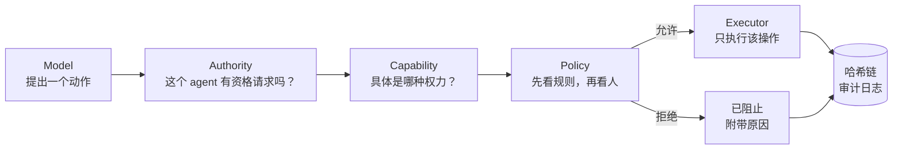
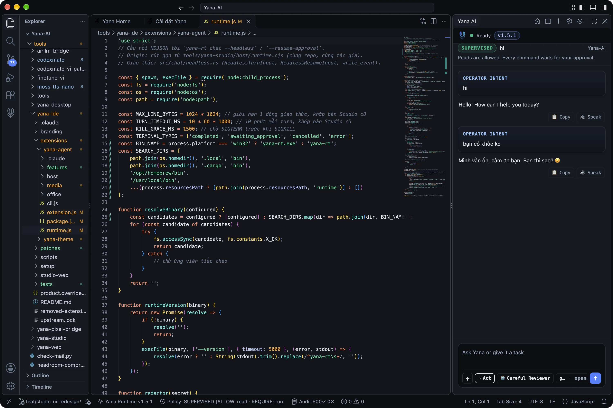

<p align="center">
  <picture>
    <source media="(prefers-color-scheme: dark)" srcset="docs/yana-banner-dark.svg">
    
  </picture>
</p>

<h3 align="center">模型提议，Yana 决定，人类掌控。</h3>

<p align="center">
  运行在本机的控制平面，位于任何 AI 模型与你机器上的真实权力之间。
</p>

<p align="center">
  <a href="https://github.com/yanacuti1121/Yana-AI/actions/workflows/ci.yml"></a>
  <a href="https://crates.io/crates/yana-rt"></a>
  <a href="https://pypi.org/project/yana-ai/"></a>
  <a href="https://github.com/yanacuti1121/Yana-AI/releases/latest"></a>
  <a href="LICENSE"></a>
</p>

<p align="center">
  <a href="README.md">English</a> ·
  <a href="README.vi.md">Tiếng Việt</a> ·
  <a href="README.ko.md">한국어</a> ·
  <a href="README.zh.md"><strong>中文</strong></a>
</p>

<p align="center">
  <a href="#快速开始">快速开始</a> ·
  <a href="#工作原理">工作原理</a> ·
  <a href="#yana-studio">Yana Studio</a> ·
  <a href="#性能">性能</a> ·
  <a href="#保护措施与边界">边界</a> ·
  <a href="https://yana.vutam.link">网站</a>
</p>

---

## 概览

<table>
  <tr>
    <td align="center" width="25%"><h3>19</h3><sub>模型 provider<br>云端 13，本地 6</sub></td>
    <td align="center" width="25%"><h3>41</h3><sub>运行时子命令<br>同一个 Rust 二进制</sub></td>
    <td align="center" width="25%"><h3>66</h3><sub>工具调用 hook<br>Pre、Post、Stop</sub></td>
    <td align="center" width="25%"><h3>290</h3><sub>核心文件<br>以 SHA-256 锁定</sub></td>
  </tr>
  <tr>
    <td align="center"><h3>4</h3><sub>agent 宿主<br>Claude Code、Codex、Cursor、Antigravity</sub></td>
    <td align="center"><h3>4.2 ms</h3><sub>运行时启动<br>release 构建，Apple M4</sub></td>
    <td align="center"><h3>100</h3><sub>专业 agent</sub></td>
    <td align="center"><h3>2,035</h3><sub>工作知识 skill，<br>不授予权限</sub></td>
  </tr>
</table>

数量由 CI 运行的 `core/scripts/check_counts.py` 直接从文件系统统计。耗时为 2026-10-20 的本地测量，
方法见[性能](#性能)一节。

## 快速开始

**桌面应用。** 从[最新发布](https://github.com/yanacuti1121/Yana-AI/releases/latest)或
[yana.vutam.link](https://yana.vutam.link) 下载 Yana Studio。

| 平台 | 安装包 |
| --- | --- |
| macOS，Apple Silicon | `.dmg` 或 `.zip` |
| Windows | `.exe`，x64 或 ARM64 |
| Linux，x86_64 | `.deb` 或 `.AppImage` |

**命令行。** 管控你已经在用的 agent：

```bash
pip install yana-ai    # Python CLI
yana-ai install        # 把 Yana 的 hook 和 rule 加入你的仓库
yana-ai doctor .       # 检查是否全部接好
cargo install yana-rt  # 原生运行时，无需 Python
```

需要 Python 3.11+（或 Rust）、Git，以及一个受支持的宿主。全部 CLI 命令见
[COMMANDS.md](COMMANDS.md)。Yana 不在 npm 上发布，参见 [VERSIONING.md](VERSIONING.md)。

> [!NOTE]
> macOS 版本为 ad-hoc 签名，**未经公证（notarization）**（目前还没有 Apple Developer
> 会员资格），因此首次启动时 Gatekeeper 会发出警告。
> [docs/MACOS_INSTALL.md](docs/MACOS_INSTALL.md) 介绍了两种官方的打开方式。
> 每个发布版本的文件列表各不相同：请确认有你的平台，并在提供 `SHA256SUMS` 时进行校验。
> 目前没有 Linux ARM 版本。

## 工作原理

模型可以说出它想做什么。是否允许由 Yana 决定，而人类随时可以叫停。所有模型都走同一条路径：
Claude、GPT、Gemini、DeepSeek，或运行在你自己机器上的模型。



Skill 教 agent 如何工作。只有 capability 才能授予行动的权限。

### 系统结构

| 组件 | 作用 | 状态 |
| --- | --- | --- |
| **[Yana Studio](tools/yana-studio)** | 面向真实项目的桌面工作区：文件、编辑器、终端、聊天、任务和设计画布。 |  |
| **[运行时 `yana-rt`](src)** | Rust 引擎，为所有客户端和所有 provider 提供同一个 turn 循环和同一份 authority 契约。 |  |
| **[Governance](core)** | Capability 清单、人工审批、哈希链审计日志、core-lock 完整性。 |  |
| **[Giám Thị](#giám-thị)** | 运行在所有 AI 会话之外的监督者，发现偏差后阻止之后的每一次工具调用。 |  |
| **[Harness 适配器](adapters)** | Claude Code、Codex、Cursor 与 Antigravity。执行强度因宿主而异。 |  |
| **[知识层](core/skills)** | 教 agent 如何工作的 agent、skill、命令和规则。它们不授予任何权限。 |  |
| **[Yana OS](src/os)** | 本地管理平面：agent 身份、自主等级、配额、健康状态、隔离。 |  |
| **[Yana Desktop / Web](tools/yana-web)** | 早期的 Electron 外壳和 Web 界面。Studio 是另行重建的，不是换皮。 |  |
| **[Yana Wheelbot](https://github.com/yanacuti1121/yana-wheelbot)** | 基于 ESP32-S3 的机器人平台，位于独立仓库。 |  |

`已上线`表示已经发布并在使用。`开发中`表示已有真实代码但功能尚不完整。`实验性`表示需要手动开启，
且尚未经过独立验证。

`yana-rt` 有 41 个子命令，不依赖 Python。这是按源码统计、覆盖所有构建配置（包括 feature flag
之后的命令）的数量。

```text
core/
├── hooks/    # 66 个 PreToolUse / PostToolUse / Stop hook（63 个 shell，3 个 JavaScript）
├── rules/    # 71 条规则，大多是 agent 自行遵守的指引，只有一部分由 hook 强制执行
├── agents/   # 100 个专业 agent
├── skills/   # 2,035 个 skill
├── commands/ # 170 个 Claude Code 斜杠命令
└── config/
    └── core-lock.json    # SHA-256 清单，锁定 290 个核心文件
```

## Yana Studio

<p align="center">
  
</p>

把在项目中与 AI 协作时需要来回切换的东西放进一个窗口。Studio 只通过 `yana-rt` 与模型通信，
界面层从不直接调用 provider。

| 区域 | 功能 |
| --- | --- |
| **文件与编辑器** | 打开真实文件夹，按文件名搜索，用 CodeMirror 编辑。8 MiB 以内的文件可编辑，更大的文件以 256 KiB 只读窗口打开。保存前会检测外部改动。 |
| **终端** | 以标签页打开的真实 PTY 会话，或最多 12 个的网格。 |
| **Git** | 只读的状态、worktree 和 diff。stage 和 commit 有意不作为 AI 工具。 |
| **聊天** | 经 `yana-rt` 流式输出，保存多个对话，停止按钮，审批提示，token 用量。 |
| **模型** | 全部 19 个 provider，外加自定义的 OpenAI 兼容端点。本地管理器可检测 9Router、Ollama、LM Studio、llama.cpp、TurboFieldfare 和 AirLLM。API key 通过 stdin 传给 Rust，加密保存在操作系统密钥库中，从不写入工作区文件。 |
| **任务** | 使用真实的 `yana-rt task` 存储。标记完成需要证据，`blocked` 状态由运行时计算。 |
| **设计画布** | 原生画布，含 22 个组件、手机和桌面屏幕、图层、撤销/重做以及受控的 AI 提议。 |
| **治理遥测** | 什么被允许，什么被阻止，以及原因。 |

尚未实现：设备列表、agent 会话界面、手机配对、SSH/Docker 执行、限时授权界面、带签名的自动更新。
各界面状态见 [`tools/yana-studio/SCREEN-STATUS.md`](tools/yana-studio/SCREEN-STATUS.md)。

<details>
<summary><b>从源码构建 Studio</b></summary>

需要 Node 24+ 以及用于 `node-pty` 的 C++ 工具链。

```bash
cd tools/yana-studio
npm ci && npm run rebuild
npm run stage:runtime -- /yana-rt/的/绝对/路径
npm start
```

</details>

## 运行时：`yana-rt`

一个 Rust 二进制负责所有客户端的 turn 循环和 authority 检查，因此 Studio、CLI 和 MCP 不必各自
重写权限逻辑。

- **Provider：** anthropic、openai、gemini、groq、deepseek、openrouter、xai、novita、nvidia、minimax、glm、huggingface、9router、kimi（云端），以及 ollama、lmstudio、llamacpp、turbofieldfare、airllm（本地）。权威列表在 [`src/model/catalog.rs`](src/model/catalog.rs)，由契约测试保证 Studio 与之同步。
- **故障转移：** 带类型的 provider 错误、备用 provider 和凭据池轮换。
- **状态：** 支持全文检索的 SQLite 会话存储、按配置文件区分的状态、崩溃恢复，以及可回滚的 shadow-git 检查点。
- **Capability 工具：** 文件读取/补丁、经过校验的命令执行、基于 stdio 的 MCP 客户端、经受检 HTTPS 层的 `web.search`，以及只读 LSP 客户端。
- **可选功能：** `mcp`、`lsp`、`pty-bridge`、Discord 远程适配器。默认构建中关闭。

运行时的剩余工作见 [CURRENT-MILESTONE.md](CURRENT-MILESTONE.md)：把所有客户端统一到同一个
capability 执行器，以及用真实本地模型而不是 mock 测试工具调用。

## 性能

2026-10-20 在 Apple M4 MacBook Air（16 GB 内存，macOS 27.2）上，用提交 `986093f5` 的 `yana-rt`
1.5.1 release 构建，以本仓库为对象测量。每个数值为 3 次运行的平均值（启动 100 次，hook 50 次）。
Python 一列是对应 Rust 命令所替代的脚本。最后一列为 2026-08-26 的测量值，完整历史和方法见
[BENCHMARK.md](BENCHMARK.md)。

| 路径 | `yana-rt` | Python | 结果 | 输出一致？ | 2026-08-26 |
| --- | ---: | ---: | --- | --- | --- |
| 进程启动 | **4.16 ms** | | | | 4.21 ms |
| `doctor` | **143 ms** | 415 ms | Rust 快 2.9 倍 | 是，双方各 16 项（11 ok、1 警告、4 info） | 255 ms，Rust 10 项对 16 项 |
| `ci check` | **5.8 ms** | 33 ms | Rust 快 5.7 倍 | 是，双方各 5 条警告 | 414 ms，Rust 0 条对 3 条 |
| `scan core/skills` | **0.55 s** | 8.47 s | Rust 快 15.5 倍 | 文件基本相同（1,791 对 1,795），首要发现相同；评分不同（40 对 0） | 4.45 s |
| HALT 检查 hook | **5.4 ms** | | | | 3.80 ms |
| 破坏性命令 guard | **4.9 ms** | | | | 未测量 |

| 内存与体积 | `yana-rt` | Python |
| --- | ---: | ---: |
| 峰值 RSS，`scan core/skills` | **17.7 MiB** | 26.5 MiB |
| 峰值 RSS，默认全仓库扫描 | **22.4 MiB** | 29.4 MiB |
| Release 二进制 | 18.2 MiB | |

与 8 月相比，`doctor` 和 `ci check` 的输出已与 Python 一致，而且都更快了。Release 二进制从约
14 MiB 增大。

> [!WARNING]
> 默认的全仓库 `scan` 目前还不是同等条件的对比。Rust 扫描 620 个文件，用时 0.36 秒，没有发现；
> Python 扫描 1,643 个文件，用时 6.14 秒，报告 9 条 critical `SE002`。这是需要补齐的一致性差距，
> 而不是快了 17 倍。token-budget guard 没有重新测量：在新的 worktree 中它的锁状态尚未初始化，
> 会提前退出，此时测得的只是错误路径。

以上为单台机器上的数据。Linux 和 Windows 尚未测量。

## Giám Thị

一个运行在所有 AI 会话之外的独立监督者，由操作系统自己的调度器（macOS 的 launchd、Linux 的
systemd timer、Windows 的任务计划程序）每 6 小时运行一次。

1. 它把仓库中控制执行的文件与人工批准的基准提交进行比较：Claude Code、Codex 和 Cursor 的 hook 配置、CI 工作流、`core/rules`、`core/gates`、`core/hooks`、`core/scripts` 和 `src/guard`。
2. 发现偏差时写入 `GIAMTHI_HALT.lock`。每次工具调用最先运行的 hook 会在锁文件存在期间拒绝一切调用。
3. 只有人删除锁文件才能解除。hook、监督者和任何环境变量都无法解除。

用 `yana-ai giamthi install | status | repair | uninstall` 管理。它需要手动开启，并且由于按计划
运行，从改动到锁定之间最多有 6 小时的间隔。Codex 只对 shell 命令触发 `PreToolUse`，因此对 Codex
还会在 `SessionStart` 和 `UserPromptSubmit` 时检查锁文件。

## Harness 适配器

| 宿主 | 如何应用治理 | 执行程度 |
| --- | --- | --- |
| **Claude Code** | `.claude/` 中的原生 hook 和规则 | 每次工具调用都在运行时拦截，哈希链审计 |
| **Codex** | `AGENTS.md`、`.codex/` hook、同步的 skill 和 agent（`yana-ai install --engine codex`） | 项目范围的 hook |
| **Cursor** | `.cursorrules`、`.cursor/rules`、`beforeShellExecution` hook | 检查 shell 命令；不覆盖 MCP 工具调用 |
| **Antigravity** | `.agents/rules/yana-ai.md` 与 `.agents/hooks.json` 中的 `PreToolUse` hook（`yana-ai install --engine antigravity`） | shell 命令由 `guard-destructive.sh` 检查；Giám Thị 的 HALT 锁阻止所有工具调用；使用 `agy --dangerously-skip-permissions` 时会被跳过 |

详情和切换命令：[adapters/README.md](adapters/README.md)。170 个 Claude Code 斜杠命令（`/plan`、
`/verify`、`/code-review` 等）位于 `core/commands/`，在会话内运行。

## 保护措施与边界

| 保护措施 | 作用 | 边界 |
| --- | --- | --- |
| **审计日志** | 哈希链结构，修改或删除任何一行都会被发现（`core/scripts/verify-audit-chain.sh`）。 | 可检测篡改，不能防止篡改。 |
| **Core-lock** | SHA-256 清单检测 `core/` 中被修改、删除或注入的文件。 | 只证明文件树与锁一致，不证明有人审查过：能改 `core/` 的人也能重新生成锁。独立检查由 Giám Thị 负责。 |
| **人工关卡** | force-push、publish、deploy 和删除需要在当前会话中确认。 | 之前的批准不会延续。 |
| **Giám Thị** | 发现问题后阻止之后的所有工具调用，直到有人移除锁。 | 需手动开启，定期运行，不是即时的。 |
| **规则与 hook** | hook 在运行时拦截。 | `core/rules` 中大多数文件描述的是 agent 自行遵守的行为，只有接入 hook 的部分才被强制执行。没有代码签名流程。 |
| **破坏性命令 guard** | `guard-destructive.sh` 拦截 `rm -rf`、force-push、`DROP TABLE` 等。 | 匹配的是命令字符串而非完整的 shell 解析，刻意构造的命令可能绕过。 |

Antigravity 只检查 shell 命令，且在 `agy --dangerously-skip-permissions` 下会被绕过；Cursor 不检查 MCP 调用，没有 Rust 运行时的纯浏览器 Web 部署未被完全管控。
详情：[已知限制](docs/reference/known-limitations.md)。

## 版本

三条轴线，各有编号和注册表：产品（不分发）、crates.io 上的 `yana-rt`、PyPI 上的 Python 包
`yana-ai`。`tools/` 下的应用通过 GitHub Releases 以各自的标签发布（Studio 为 `studio-v*`）。
当前版本号容易过时，本页有意不写，上方徽章会实时显示。参见 [VERSIONING.md](VERSIONING.md)。

## 更多

[ARCHITECTURE.md](ARCHITECTURE.md) · [PHILOSOPHY.md](PHILOSOPHY.md) · [ROADMAP.md](ROADMAP.md) · [CURRENT-MILESTONE.md](CURRENT-MILESTONE.md) · [CHANGELOG.md](CHANGELOG.md) · [BENCHMARK.md](BENCHMARK.md) · [CONTRIBUTING.md](CONTRIBUTING.md) · [SECURITY.md](SECURITY.md) · [致谢](ACKNOWLEDGEMENTS.md) · [渊源](docs/history/LINEAGE.md)

---

<p align="center">
  一个人打造，没有团队，没有融资：<b>Vũ Văn Tâm</b>，越南<br>
  <a href="https://yana.vutam.link/">yana.vutam.link</a> · phamlongh230@gmail.com · <a href="LICENSE">Apache 2.0</a>
</p>
